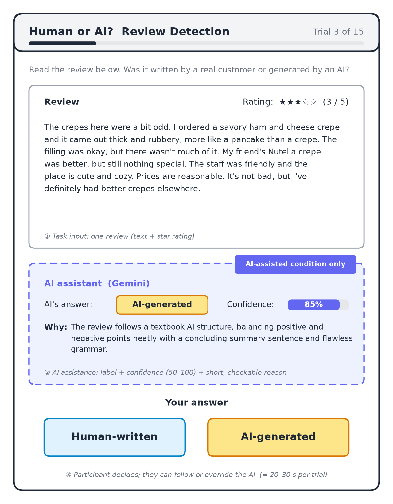

# Assignment 2: "Human or AI?" Review Detection

Code and data: `HAI-task/` (see `README.md` for how to run everything).

---

## a. A description of your task, including what will be given to the task performer, and what is expected of them to do.

**Task:** decide whether a short online review was written by a real customer or generated by an AI language model.

**What the performer is given (one task trial):**
- A Yelp-style review of a business (restaurants, bars, hotels, shops, salons, clinics, car services, etc.), usually 80–150 words.
- The review's star rating (1–5).
- In the AI-assisted condition, also the AI's label, its confidence score and a short reason (see section b).

**What the performer must do:** choose one of two labels, **Human-written** or **AI-generated**. A trial takes about 20–30 seconds, so a participant can complete roughly 15–20 trials in a 10-minute session.

*Figure 1: Mock-up of one task trial (illustration only, not the final interface). (1) The participant sees one review and its star rating. (2) In the AI-assisted condition only, a panel shows the AI's label, confidence and reason. (3) The participant picks "Human-written" or "AI-generated", following or overriding the AI. The review and AI output shown are real: study trial 192, an AI-written review that Gemini correctly labelled "AI-generated" with 85% confidence.*

### i. Existing dataset used, with link, and any sampling/curation/modification

The human-written half comes from **Yelp Review Full**: https://huggingface.co/datasets/Yelp/yelp_review_full. It contains 700,000 real Yelp reviews labelled with star ratings 1–5. I used the 50,000-review test split and made these changes:
- **Cleaning:** replaced escaped newlines (`\n`) and escaped quotes with plain spaces and quotes.
- **Length filter:** kept only reviews of 80–150 words, so each trial can be read in under 30 seconds.
- **Balanced sampling:** sampled 46 reviews per star rating (230 in total) with a fixed random seed (594), then shuffled them.
- **Split:** the first 115 reviews became human-written trials. The other 115 were used only as prompts for generating the AI reviews and never appear in the study set as human trials.

### ii. Own task and dataset (Step D, bonus)

**Note: I designed my own task and created my own dataset for the Step D bonus.** The human-written half comes from an existing dataset (above). The AI-generated half and the combined, labelled study set are new.

**How the AI-generated reviews were created:**
1. For each of the 115 seed reviews, I built a generation prompt (saved in `data/seeds.csv`) that keeps the seed's star rating and word count and uses its first sentence as loose inspiration:
   > Write a Yelp review as an ordinary customer would post it.
   > – Rating: {stars} out of 5 stars (match the tone to the rating).
   > – Length: about {words} words, a single block of text.
   > – Loosely inspired by this opening line from another review (do NOT copy it): "{hint}"
   > Output only the review text, no title or star count.
2. Claude (`claude-opus-5-5`, running in Claude Code) wrote one review per prompt. The outputs are saved in `data/ai_reviews.jsonl`. They were written directly, not through an API call. This only affects how the dataset was made; the AI assistance model (section b) is accessed through an API.
3. Matching each AI review to a seed's star rating and length means participants can't tell the two classes apart by rating or length alone.

**Final study dataset (`data/study.csv`): 200 trials, 100 Human and 100 AI, shuffled.**

| | 1★ | 2★ | 3★ | 4★ | 5★ |
|---|---|---|---|---|---|
| Human | 19 | 20 | 16 | 23 | 22 |
| AI | 22 | 20 | 18 | 18 | 22 |

- **Length:** the median is 106 words for both classes (means: Human 109.6, AI 112.0). 18 of the 100 AI reviews fall outside the 80–150-word range used for human reviews (69–161 words).
- **Spares:** another 15 human and 15 AI reviews are held back in `data/pool.csv`. Four of them are used as labelled examples in the detector's prompt (section f). None of the spares appear in the study set.
- **Columns:** `id, text, stars, source_model, ground_truth, model_output, model_confidence, model_reason`. `ground_truth` is known by construction: real Yelp review = Human, generated = AI.

---

## b. A description of the AI assistance and the model, the steps taken to implement or access it, and a screenshot of a model output for a task trial.

**The AI assistance:** the model performs the whole task and shows its answer to the participant as advice, which they can accept or override. For each review it returns:
- **Label:** Human or AI.
- **Confidence:** 50 (pure guess) to 100 (certain).
- **Reason:** one or two sentences pointing to concrete cues in the text that the participant can check for themselves.

The reason is the key part of the assistance. It lets the participant verify the AI's evidence rather than simply trust or ignore the label.

**The model:** Google **Gemini `gemini-3.5-flash-lite`**, an off-the-shelf large language model accessed through the Gemini API (free tier). It runs zero-training, prompt-based classification with a few labelled examples in the prompt.

**Why a different model family from the review-writer:** the AI reviews were written by Claude, and LLMs can recognize and favour their own generations (Panickssery et al., 2024). Using a Gemini detector means the detector never judges text from its own model family, which keeps its accuracy from being inflated (or deflated) by self-recognition.

**Steps taken to access and implement the model:**
1. Created a Gemini API key in Google AI Studio and stored it in a local `.env` file (not committed to git).
2. Installed the Google Gen AI Python SDK (`google-genai`) in a virtual environment (`requirements.txt`).
3. Wrote `run_model.py`. Its function `detect(text, stars)`:
   - sends the review and star rating to Gemini with a system prompt (section f);
   - requests **structured JSON output** with a fixed schema (`label` ∈ {Human, AI}, `confidence` as an integer, `reason` as a string), so every response can be parsed reliably;
   - uses temperature 0 and a low "thinking" level, so answers are deterministic and arrive in about 2–3 seconds, fast enough for the live interface in Assignment 3.
4. Ran `detect` over all 200 trials. The free tier allows 15 requests per minute, so the script waits 5 seconds between calls, retries rate-limit errors, and saves each result as it arrives (`data/model_outputs.jsonl`), so a stopped run can resume.
5. Merged the outputs into `data/study.csv` and evaluated them with `evaluate.py`.

**Model choice history:** `gemini-2.5-flash` was no longer available to new API users. `gemini-3.8-flash` worked, but its free tier allows only 20 requests per day. I therefore used `gemini-3.5-flash-lite`, whose free-tier limit is per minute, not per day.

**Example model output for a task trial (trial id 130, truth = AI):**
> *Review:* "Worst sandwich I've had in a long time. I ordered the Italian sub and the bread was stale and hard, like it had been sitting out all day. … I took two bites and threw the rest away. Never again."
> *Model output:* `{"model_output": "Human", "model_confidence": 90, "model_reason": "The review features a natural, conversational tone with uneven pacing and an abrupt, definitive ending ('Never again.'), which are typical human traits rather than the structured format of AI."}`

*[Insert screenshot 1: terminal running `python run_model.py "<a review>"`, showing the JSON output.]*
*[Insert screenshot 2: the end of the full run, "labelled 200/200 trials with gemini-3.5-flash-lite", and/or the `evaluate.py` output.]*
*[Optional screenshot 3: the Google AI Studio API key page, with the key hidden.]*

---

## c. A justification for your choices of task and model: why the human task performers can benefit from the AI assistance, but should not delegate the task to AI.

**Why the task matters:** AI-generated reviews are a real and growing problem for review platforms and consumers. Deciding whether a review is genuine is also a decision people make every day when shopping or choosing a restaurant.

**Why humans benefit from the AI:**
- **People are poor at this task on their own.** Untrained evaluators distinguish human-written from modern AI-written text at roughly chance level (Clark et al., 2021). Modern AI reviews are fluent, conversational and full of specific-sounding details, the same features people use as evidence of a real customer.
- **The model picks up a different set of signals.** It responds to global regularities that people tend to miss: very tidy structure (verdict → details → balanced caveat → recommendation), consistently correct punctuation, and stock phrasing. After iteration it reaches 83.5% accuracy, well above the chance-level performance expected from humans.
- **Its confidence is informative.** When it says 95–100, it is right 97% of the time. When it says 85 or lower, only 67% of the time. Participants can use this to decide when to rely on it.

**Why humans should not delegate to the AI:**
- **It makes systematic errors that a careful reader can catch.** It is wrong on 1 in 6 trials (33/200). Most errors follow two patterns: it confuses sentiment with authorship (glowing human reviews called AI, punchy negative AI rants called human), and it takes surface style for authorship (list-formatted human reviews called AI).
- **Its explanations are often unfaithful to the text.** In 42% of its errors (14/33), the reason misstates the review. It claims "flawless grammar" for reviews with obvious typos ("ruben", "Definately", "Eat bite"), or quotes phrases ("do yourself a favor", "go out of your way") that do not appear in the review. A human who reads the review can see this immediately and override the AI.
- **The stakes are real.** Wrongly accusing a genuine customer of posting fake content, or letting fake reviews through, has consequences for businesses and users, so a human should own the final decision.
- **It doesn't generalize reliably.** The detector was tuned with a prompt on one generator's text. Its accuracy on reviews from other AI models, other languages (it misclassified the one Portuguese review) or other domains is unknown, while human judgment transfers more naturally.

**Why this model:**
- It is accessed through an API, so it can be called live in the Assignment 3 interface.
- It gives a label, a confidence score and a natural-language reason in one call. The reason is what makes complementarity possible: it lets the participant check the AI's evidence.
- It's free and fast (about 2–3 seconds per call).
- It comes from a different model family than the review-writer, which avoids self-recognition bias.
- Its accuracy (83.5%) is in the useful middle range: high enough to help, low enough that blind delegation would be a mistake.

---

## d. A report of model evaluation results and error analysis, with the metrics chosen and why.

### Metrics and why

- **Accuracy:** the main metric. The study set is perfectly balanced (100/100), so accuracy is not inflated by a majority class. It is also the measure we'll compare across the AI-only, human-only and human-AI conditions in Assignment 3.
- **Per-class precision, recall and F1, plus the confusion matrix:** accuracy alone hides which way the model errs. The direction matters for the task, because calling a real customer "AI" and letting a fake review pass as "Human" are different failures. These are standard metrics for binary classification (Sokolova & Lapalme, 2009).
- **Accuracy by confidence level (calibration):** the participant sees the confidence score, so it must mean something. A calibration check shows whether higher stated confidence actually goes with higher accuracy (Guo et al., 2017).
- **Accuracy by star rating:** to check whether performance depends on review sentiment.

All metrics are computed by `evaluate.py` from `data/study.csv` and can be replicated with `python evaluate.py`.

### Results (final model, 200 trials)

**Overall accuracy: 83.5% (167/200).**

| Class | Precision | Recall | F1 | Support |
|---|---|---|---|---|
| AI | 0.807 | 0.880 | 0.842 | 100 |
| Human | 0.868 | 0.790 | 0.827 | 100 |
| Macro average | 0.838 | 0.835 | 0.835 | 200 |

**Confusion matrix (rows = truth, columns = prediction):**

| | Predicted Human | Predicted AI |
|---|---|---|
| **True Human** | 79 | 21 |
| **True AI** | 12 | 88 |

The model leans towards calling reviews "AI": it wrongly flags 21 human reviews and misses 12 AI reviews.

**Accuracy by stated confidence:**

| Confidence | Trials | Accuracy |
|---|---|---|
| 95–100 | 61 | 96.7% |
| 90 | 79 | 86.1% |
| 75–85 | 60 | 66.7% |

Confidence is well ordered: higher confidence goes with higher accuracy. The model never reports less than 75, so even its "uncertain" answers are stated with fairly high confidence. That's a reason for participants not to take the number at face value.

**Accuracy by star rating:** 1★ 80.5%, 2★ 90.0%, 3★ 94.1%, 4★ 80.5%, 5★ 75.0%. Performance is worst at the extremes, especially for 5-star reviews.

### Error analysis

I read all 33 misclassified trials (`data/errors.csv`) and assigned each one a single main pattern (`data/error_tags.csv`).

**Error distribution table:**

| Error pattern | Direction | # errors | % of errors |
|---|---|---|---|
| Glowing, enthusiastic positive human review read as AI | Human → AI | 15 | 45.5% |
| AI negative rant with a punchy, abrupt ending ("Never again.", "Not going back.") read as human | AI → Human | 7 | 21.2% |
| AI review framed with a personal backstory ("As someone from the Philly area…", "Another comped dinner…") read as human | AI → Human | 5 | 15.2% |
| Balanced, measured mixed human review read as "tidy AI structure" | Human → AI | 2 | 6.1% |
| Human review with a list-like format (pros/cons, per-item ratings, "Verdict:") read as AI | Human → AI | 2 | 6.1% |
| Non-English (Portuguese) human review | Human → AI | 1 | 3.0% |
| Clean-prose human complaint read as AI | Human → AI | 1 | 3.0% |
| **Total** | | **33** | **100%** |

**Cross-cutting issue:** in **14 of the 33 errors (42%)**, the model's reason misstates the text. It claims "flawless grammar" despite visible typos, or quotes phrases that don't appear in the review, apparently borrowed from the cue list in its own prompt.

**The underlying pattern is that the model uses sentiment as a stand-in for authorship.**
- 17 of its 21 false "AI" calls are 4–5-star reviews.
- 10 of its 12 false "Human" calls are 1–2-star reviews.

It has learned that enthusiastic, well-organized praise "sounds like AI" and that angry, blunt complaints "sound human". That is not a reliable cue.

### Are these errors avoidable by human performers?

| Error pattern | Can a human catch it? |
|---|---|
| Glowing human reviews read as AI (45.5%) | **Often, yes.** Many contain clear signs of a human writer that the model ignored: misspellings ("ruben", "Definately", "Eat bite"), irregular punctuation ("....ever!", "..", "...!"), naming specific staff ("Judy, Sandra and Fabi"), references to other reviewers, sign-offs like "Cheers,". When the AI's reason says "flawless grammar" and the reader sees a typo, they have a concrete reason to override it. |
| List-format and non-English human reviews (9.1%) | **Yes.** A person easily recognizes a Yelp regular's habit of "Pros/Cons/Verdict" formatting, and a Portuguese review is not evidence of AI. |
| Balanced mixed human reviews (6.1%) | **Partly.** Hard for both humans and AI, though local details ("gvr", "the Old Port") help. |
| AI rants and AI backstory reviews read as human (36.4%) | **Harder.** These were written to sound like ordinary customers, and humans are likely to be fooled as well. Here humans and the AI probably share the same blind spot. |

Overall, a large share of the AI's errors, especially the biggest category and the unfaithful-reason cases, can be caught by a human who reads the text and checks the AI's stated evidence. That's where human-AI complementarity should come from.

---

## e. Your prediction on ranking AI-only, human-only and human-AI joint performances, and why.

**Prediction: AI-only (≈84%) > Human-AI joint (≈75–80%) > Human-only (≈55–60%).**

**Human-only will be lowest.** Prior work shows that people distinguish human-written from AI-written text at close to chance (Clark et al., 2021). The AI reviews here were written to be indistinguishable in rating, length and topic. I expect classmates to rely on the same misleading cues the zero-shot model used (conversational tone and specific details mean human), so they will label most AI reviews as human, as the model did in iteration 1 (53%).

**Human-AI joint will be well above human-only.** The AI is far more accurate than humans and its confidence is informative (97% correct at 95–100 confidence). Participants who mostly follow it will improve a lot.

**But I predict Human-AI will still fall below AI-only.** When an AI is much more accurate than its human partners, joint teams usually land between the two: people override correct AI answers about as often as they fix wrong ones (Bansal et al., 2021).
- **Over-overriding:** participants will see reasons like "tidy structure" or "polished phrasing" that don't match their intuition, and will override correct "AI" calls.
- **Shared blind spot:** on 36% of the AI's errors (AI rants and backstory reviews), humans are likely to agree with the AI's wrong "Human" call, so those errors stay uncorrected.
- **Too little benefit:** the errors humans could correct, such as typos the model ignored in glowing human reviews, are a minority of trials (about 21 of 200). Catching some of them may not offset the overrides.

**What would change this:** if participants use the confidence score well (accepting 95–100 and checking 85-or-below against the text) and spot unfaithful reasons, Human-AI could match or slightly exceed AI-only. That is the complementarity scenario Assignment 3 will test.

---

## f. A description of whether iterations were needed and why (Step J), and what you did.

**Yes, two kinds of iteration were needed: one on the model and prompt, and two on the study design.**

### Iteration 1: model too weak (zero-shot prompt), 53.0% accuracy

**First version:** a zero-shot system prompt asking the model to label the review and give a confidence score and a reason.

**Result:** 53.0% accuracy, barely above chance.
- It labelled 190 of 200 reviews "Human" (Human recall 98%, AI recall 8%).
- It never reported less than 85 confidence (mean 92.8).
- Its reasons showed why: it treated any conversational review with specific details ("flagged someone down", "moved to Arizona five years ago") as evidence of a human. Modern AI reviews have exactly those features.

At this level the model would be useless as assistance and actively misleading, since it was confidently wrong on 92 of the 100 AI reviews. This matches the Step J case "the model is too bad at the task and would not be helpful".

These results are kept in `data/study_iter1_zeroshot.csv` and `data/errors_iter1_zeroshot.csv`.

### Iteration 2 (final): improved prompt, 83.5% accuracy

I improved the model without touching the study set. The new system prompt adds:
1. **The base rate:** about half of the reviews are AI-generated.
2. **A correction:** a natural tone and specific details alone are not evidence of a human.
3. **Cue lists:**
   - pointing to AI: tidy verdict → details → caveat → recommendation structure, flawless mechanics, stock phrases, neatly resolved complaints;
   - pointing to a human: typos, run-ons, odd punctuation, slang, abrupt endings, tangents, references to other reviewers or very local details.
4. **Four labelled examples** (2 human, 2 AI) taken from the spare reviews, which are not part of the study set, so there's no leakage into the evaluation.

A quick 20-trial check gave 85%, so I ran the full set: **83.5% accuracy, balanced across classes (AI recall 88%, Human recall 79%), with informative confidence.** This falls inside the 70–85% target I set at the start: good enough to help, not good enough to justify full delegation.

**Caveat:** the cue list was written partly with knowledge of how the generated reviews read, so the 83.5% may be somewhat optimistic for AI reviews from other models.

### Design iterations (before evaluation)

- **Changing the detector model to avoid self-recognition bias.** The first design used Claude both to generate reviews and to detect them. Since LLMs can recognize their own outputs (Panickssery et al., 2024), I changed the detector to a different model family (Gemini), so that AI-only performance reflects detection ability, not self-recognition.
- **Changing models because of free-tier limits.**
  - `gemini-2.5-flash` was unavailable to new API users.
  - `gemini-3.8-flash` allows only 20 free requests per day, not enough for 200 trials, let alone the Assignment 3 study.
  - I switched to `gemini-3.5-flash-lite` (per-minute limit) and added throttling, retries and per-trial saving, so a stopped run can resume.

### Study dataset checks (no changes needed)

- The label balance is exactly 100/100.
- Star ratings are spread across all five values in both classes.
- Median length is identical (106 words).

I did not curate the study set to make the model look better. All iteration was done on the prompt, using only spare reviews.

---

## References

- Bansal, G., Wu, T., Zhou, J., Fok, R., Nushi, B., Kamar, E., Ribeiro, M. T., & Weld, D. (2021). Does the Whole Exceed its Parts? The Effect of AI Explanations on Complementary Team Performance. *CHI 2021*.
- Clark, E., August, T., Serrano, S., Haduong, N., Gururangan, S., & Smith, N. A. (2021). All That's 'Human' Is Not Gold: Evaluating Human Evaluation of Generated Text. *ACL 2021*.
- Guo, C., Pleiss, G., Sun, Y., & Weinberger, K. Q. (2017). On Calibration of Modern Neural Networks. *ICML 2017*.
- Panickssery, A., Bowman, S. R., & Feng, S. (2024). LLM Evaluators Recognize and Favor Their Own Generations. *NeurIPS 2024*.
- Sokolova, M., & Lapalme, G. (2009). A systematic analysis of performance measures for classification tasks. *Information Processing & Management, 45*(4).
- Zhang, X., Zhao, J., & LeCun, Y. (2015). Character-level Convolutional Networks for Text Classification. *NeurIPS 2015* (source of the Yelp Review Full dataset).
